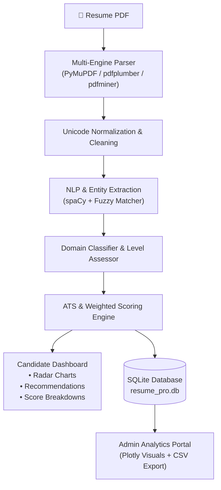

<div align="center">

# 🎯 AI Resume Analyser Pro
### *Next-Generation NLP & Multi-Engine ATS Resume Intelligence Platform*

[](https://ai-resume-analyser-pro.streamlit.app/)
[](https://www.python.org/)
[](https://streamlit.io/)
[](https://spacy.io/)
[](https://plotly.com/)
[](LICENSE)
[](https://github.com/ahadahmed123456789/ai-resume-analyser-pro)

<p align="center">
  <b>A comprehensive, AI-powered resume parsing and ATS evaluation system designed to extract skills, calculate weighted ATS compatibility scores, detect candidate domain proficiency, and recommend targeted career roadmaps.</b>
</p>

🔗 **Live Application URL:** [**https://ai-resume-analyser-pro.streamlit.app/**](https://ai-resume-analyser-pro.streamlit.app/)

[Live Demo](#-live-demo) • [Key Features](#-key-features) • [Architecture](#-architecture) • [Getting Started](#-getting-started) • [Admin Dashboard](#-admin-dashboard) • [Contact](#-author)

---

</div>

## 🌐 Live Demo

The application is deployed live and publicly accessible on Streamlit Community Cloud:

👉 **[https://ai-resume-analyser-pro.streamlit.app/](https://ai-resume-analyser-pro.streamlit.app/)**

---

## 🌟 Key Features

### 🔍 1. Multi-Engine PDF Parsing
- **Tri-Engine Architecture**: Automatically attempts parsing via **PyMuPDF (`fitz`)**, **`pdfplumber`**, and **`pdfminer`** for resilient extraction.
- **Ligature & Icon Stripping**: Normalizes Unicode typography, removing corrupted font glyphs and complex multi-column distortions.
- **Section Detection**: Intelligent regex and keyword proximity mapping for Education, Work Experience, Projects, and Skills.

### 🧠 2. Hybrid NLP & Phonetic Skill Extraction
- **spaCy Named Entity Recognition (NER)** coupled with rule-based regex and pattern tokenizers.
- **Fuzzy Skill Matching**: Levenshtein ratio matching (similarity threshold $\ge$ 0.82) to match variations, abbreviations, and typos (e.g., `k8s` $\rightarrow$ `Kubernetes`, `react.js` $\rightarrow$ `React`).
- **Domain Identification**: Automatic classification across Data Science, Web Development, Mobile (Android/iOS), and UI/UX engineering.

### 📊 3. ATS Scoring & Visual Gap Analytics
- **Weighted Scoring Algorithm**: Evaluates resume structure, keyword relevance, experience depth, and formatting.
- **Interactive Radar Chart**: Visualizes skill depth against industry benchmarks across multiple competency pillars.
- **ATS Compatibility Score**: Pinpoints missing must-have keywords, section deficiencies, and formatting improvements.

### 🎓 4. Smart Upskilling & Recommendations
- Curated course recommendations from top platforms (Google, Coursera, Udacity, Udemy, LinkedIn Learning).
- Embedded interview and resume-building video guides.

### 🛡️ 5. Analytics & Admin Dashboard
- **Secure Portal**: Access candidate submission history and aggregate metrics.
- **Interactive Visualizations**:
  - Predicted domain distribution pie chart
  - Experience level distribution
  - Resume score vs. ATS score scatter plot
  - Submission activity timeline
  - PDF parser engine utilization
- **Data Export**: 1-click export of candidate records to CSV format.

---

## 🏗️ Architecture



---

## 💻 Getting Started

### Prerequisites
- Python 3.11 (recommended) or 3.10
- Git

### 1. Clone the Repository
```bash
git clone https://github.com/ahadahmed123456789/ai-resume-analyser-pro.git
cd ai-resume-analyser-pro
```

### 2. Set Up Virtual Environment
```bash
# Windows
python -m venv venv
.\venv\Scripts\activate

# macOS / Linux
python3 -m venv venv
source venv/bin/activate
```

### 3. Install Dependencies
```bash
pip install --upgrade pip
pip install -r requirements.txt
python -m spacy download en_core_web_sm
```

### 4. Run the Application
```bash
streamlit run app.py
```
Open your browser and navigate to `http://localhost:8501`.

---

## 🔐 Admin Dashboard

The built-in analytics dashboard enables recruiters or administrators to inspect past candidate evaluations.

- Switch to **Admin** mode in the sidebar navigation.
- **Default Credentials:**
  - **Username:** `admin`
  - **Password:** `admin123` *(configurable in code or via environment variables)*

---

## 📁 Project Structure

```text
ai-resume-analyser-pro/
├── app.py                  # Main Streamlit application (Ultra Pro v2.0)
├── Courses.py              # Curated courses, videos, and career tracks
├── requirements.txt        # Python dependency manifest
├── LICENSE                 # MIT License
├── README.md               # Project documentation
├── Uploaded_Resumes/       # Local temporary storage for uploaded resumes
└── resume_pro.db           # SQLite database (auto-generated at runtime)
```

---

## 🛠️ Tech Stack

| Category | Technologies |
| :--- | :--- |
| **Frontend / App Framework** | [Streamlit](https://streamlit.io/) |
| **Natural Language Processing** | [spaCy](https://spacy.io/), [NLTK](https://www.nltk.org/), Regular Expressions |
| **Document Parsing** | [PyMuPDF (fitz)](https://pymupdf.readthedocs.io/), [pdfplumber](https://github.com/jsvine/pdfplumber), [pdfminer.six](https://github.com/pdfminer/pdfminer.six) |
| **Data & Visualizations** | [Pandas](https://pandas.pydata.org/), [Plotly Express & Graph Objects](https://plotly.com/python/) |
| **Database** | [SQLite3](https://www.sqlite.org/) |

---

## 👤 Author

**Ahad Ahmed**
- **Live App:** [ai-resume-analyser-pro.streamlit.app](https://ai-resume-analyser-pro.streamlit.app/)
- **Portfolio:** [ahadahmed.is-a.dev](https://ahadahmed.is-a.dev)
- **GitHub:** [@ahadahmed123456789](https://github.com/ahadahmed123456789)
- **Email:** [ahadahmed786921@gmail.com](mailto:ahadahmed786921@gmail.com)

---

## 📄 License

This project is licensed under the MIT License - see the [LICENSE](LICENSE) file for details.
